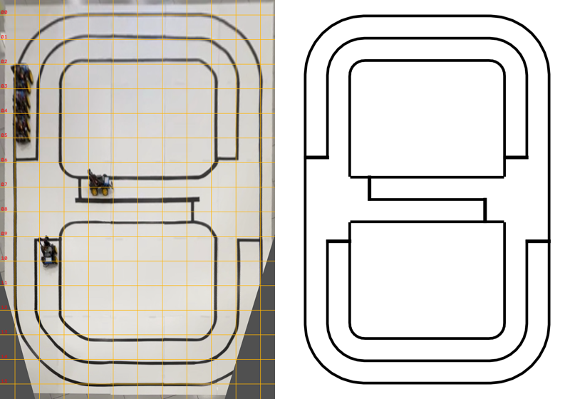

# 실물 코스 치수 추정 (사진 기반, 2026-11-10)

실측이 당분간 어려워, 코스 사진 한 장과 사진 속 PiCar 크기로 치수를 추정했다. **실측값이 생기면 `picar_sim/config/course.yaml`의 `ESTIMATED` 값을 바꾸고 SUMO 맵·Gazebo 월드를 다시 생성한다**(둘 다 같은 파일에서 만들어진다).

왼쪽: 원근을 보정한 사진(격자 0.1 W, W = 바깥선 폭). 오른쪽: 추정 치수로 생성한 Gazebo 바닥 텍스처(사진과 같은 방향으로 회전).

## 방법

1. 사진에서 선이 지나는 픽셀을 주사선으로 자동 추출했다(바깥선, 가운데선, 섬 경계선, 연결로 선).
2. 바닥이 평면이라는 가정으로 사진 → 평면 변환(호모그래피)을 최소제곱으로 맞췄다. 미지수: 변환 8개, 코스 세로/가로 비, 바깥 차로 폭, 안쪽 차로 폭.
   "바깥 차로 폭은 네 변에서 같다"는 조건이 세로/가로 비를 정해 준다. 맞춤 오차는 코스 폭의 0.2%다.
   스크립트: [img/fit_course_from_photo.py](img/fit_course_from_photo.py).
3. 절대 크기는 PiCar 크기(0.24 × 0.17 m, 기존 가정값)로 정했다. 옆에서 보인 차 길이는 0.100 W, 위에서 보인 차 폭은 0.077 W로, 각각 W = 2.40 m와 2.21 m가 나온다. 둘의 평균인 **W ≈ 2.30 m**를 쓴다. 바닥 타일(60 cm로 가정)로도 비슷한 값이 나온다.

## 결과

| 항목 | 사진 비율 | 추정값 | 이전 가정값 |
|---|---|---:|---:|
| 바깥선 긴 변 | 1.504 W | **3.46 m** | 3.5 m |
| 바깥선 짧은 변 | 1 W | **2.30 m** | 2.2 m |
| 차로 폭(선 중심 간격) | 0.090~0.094 W | **0.21 m** | 0.35 m |
| 연결로 위치 | 긴 변의 0.50 | 가운데 | 가운데 |
| 정지선 → 교차로 경계 | 0.07~0.084 W | **0.17 m** (순환로 0.16, 연결로 0.19) | 0.12 m |
| 모서리 반경(가운데선) | 약 0.15 W | **0.35 m** | 0.40 m |

- 구조는 사진과 같다. 바깥 순환로와 가운데 연결로가 있고, 긴 변 가운데에 T자 교차로 2곳이 있다. 우측통행이며 방향마다 1차로다.
- 선은 도로마다 3줄이다(바깥 끝선, 가운데선, 안쪽 끝선). 가운데선은 정지선에서 끝나고, 교차로 안에는 직진 도로의 먼 쪽 끝선만 이어진다. 정지선은 진입하는 차로만 가로지른다. **접근(APPROACH) 표식 테이프는 없다**(차량이 주행 거리로 판단).
- 차로가 0.21 m로 좁다. 차 폭 0.17 m 기준으로 양옆 여유가 2 cm씩이다. 차로 이탈 판정은 "차체가 선 하나를 완전히 덮음"으로 바꿨다. 기준은 차로 중심에서 (0.21 − 0.17)/2 + 0.025 = **4.5 cm**다.
- 바뀐 치수로 SUMO 맵을 다시 만들면 연결로에 들어갈 수 있는 차가 방향당 1대에서 3대로 늘어난다. 교차로 흐름이 달라지므로 DQN을 다시 학습했다(`runs/picar_v9_photo_rt`).

## 불확실성

- 크기는 ±5% 정도로 본다. 차 크기 가정에 비례하고, 렌즈 왜곡은 보정하지 않았다(사진 아래쪽 모서리가 가장 부정확하다).
- 차로 폭은 비율로 구해서 크기 오차의 영향만 받는다. 0.20~0.22 m 범위다.
- 섬 모서리 반경, 테이프 폭(0.025 m 가정), 정지선 두께(0.03 m 가정)는 사진 해상도로는 정확히 알 수 없다.
- 실측할 곳: 전체 가로·세로, 차로 폭, 연결로 위치, 가운데선이 끊긴 구간, 정지선 6곳, 모서리 반경, 테이프 폭. 차량은 길이·폭, 카메라 높이·위치·숙인 각도·화각, IR 센서 위치가 필요하다.
