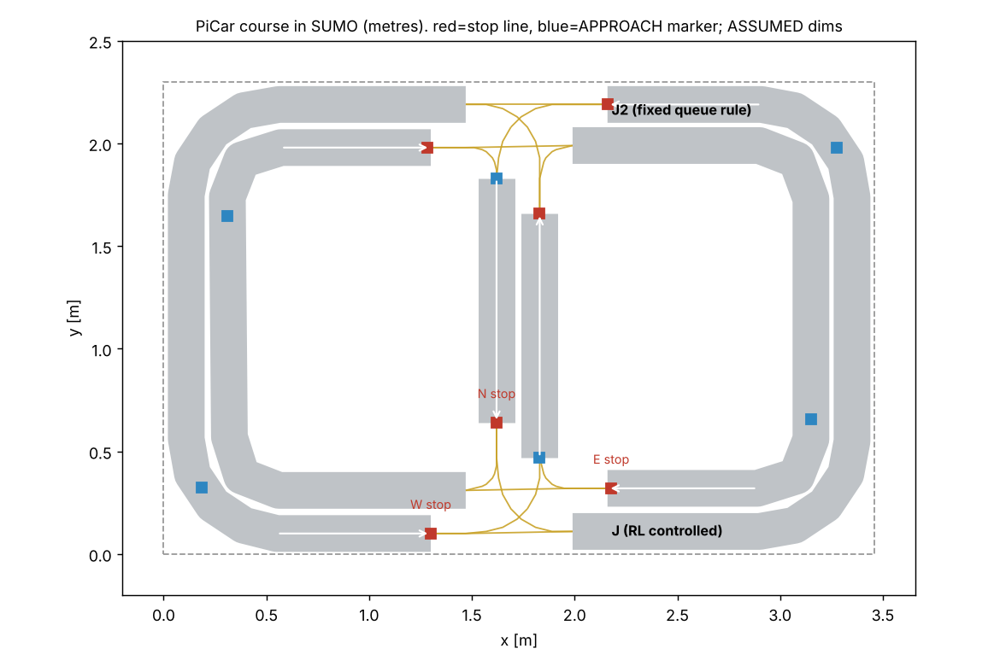

# PiCar Real-to-Sim SUMO 강화학습 계획과 구현 (2026-11-09)

목표는 실물 PiCar 코스를 미터 단위 SUMO 맵으로 옮기고, T자 한 곳의 **진입 허가(GO/STOP)**를 DQN으로 학습한 뒤, 같은 상태·안전 규칙으로 실차에 옮기는 것이다(Sim-to-Real).
PiCar는 기존처럼 라인트래킹과 정지를 맡는다. DQN은 현시 전환만 요청하고, 독립 `IntersectionSupervisor`만 GO를 낸다.
**실차가 없어서 실차 검증은 하지 않았다.** 아래의 SUMO 결과는 가정 치수와 가정 동특성에서 나온 값이다.

## 1. 구조

```text
[SUMO 또는 실차]  가상/실제 센서 이벤트 (APPROACH 표식, 정지선 IR=ARRIVE, IN, 출구 센서=EXIT)
        │                               ※ SUMO 정답값은 보상·지표에만 쓰고 관측에는 쓰지 않음
        ▼
  CarLedger + SegmentTracker ──► Encoder (schema picar_v1, 25차원) ──► Policy (DQN) ──► 현시 요청
                                                                                    │
  출구 센서 heartbeat·UDP 링크 상태 ──────────────────────────► IntersectionSupervisor ◄┘
                                                                     │  (최소·최대 녹색, 황색,
                                                                     │   점유 0 확인 후 전환, 결함 시 전면 STOP)
                                                                     ▼
                     접근로별 GO/STOP × 다음 구간 여유 확인(박스 막힘 방지) ─► SUMO 신호 / 실차 PERMIT(TTL)
```

| 파일 | 역할 |
|---|---|
| `picar_sim/config/course.yaml` | 코스·차량·신호·보상·랜덤화·시나리오. ASSUMED 표시값은 실측으로 교체 |
| `picar_sim/map_builder.py` | 코스를 SUMO 네트워크(.net.xml)로 생성하고 검증. 탑뷰 PNG 생성 |
| `picar_sim/supervisor.py` | 독립 안전 제어기. SUMO와 실차 중앙 PC가 같은 클래스를 씀 |
| `picar_sim/observation.py` | 차량 상태 원장(CarLedger)과 상태 인코더. 모르는 값을 0으로 채우지 않음 |
| `picar_sim/env.py` | SUMO 환경. 차량 N대 순환, 명령·관측 지연, IR 놓침, UDP 손실, 결함 주입, 지표 |
| `picar_sim/baselines.py` | 고정식, 대기열 규칙 (DQN과 같은 관측만 사용) |
| `picar_sim/dqn.py` | 마스크 Double DQN. PyTorch가 있으면 torch(GPU 자동), 없으면 numpy. 공용 `.npz` 정책 |
| `picar_sim/train.py`, `evaluate.py`, `run_all.py` | 학습(재개 가능), 짝지은 평가, 원커맨드 실행 |
| `picar_sim/real_bridge.py` | 실차 중앙 PC: UDP 상태 → 원장 → 정책 → 안전 제어기 → PERMIT. shadow/active, 로그 재생 |
| `picar_sim/calibrate.py` | 실측 CSV → 파라미터 갱신(보정 60%), 나머지 40% 회차로 sim-real 통과시간 비교 |
| `picar_sim/tests/test_picar_sim.py` | 안전 규칙, 결함 시 진입 0, numpy DQN, **SUMO 기록 → 실차 브리지 재생 시 행동 일치** |
| `notebooks/08_picar_real2sim_colab.ipynb` | Colab(GPU) 실행 |

## 2. 맵 가정과 파라미터

사진을 받지 못해 사용자 설명(외곽 순환로, 중앙 연결 구간, T자 접속부, 정지선; 3.5 × 2.2 m 초안)을 아래처럼 해석했다.
저장소의 `picar_lab/docs/track-layout.svg`(6 × 4 m T자 초안)는 다른 배치라서 쓰지 않았다. 실물이 그쪽이면 `map_builder.road_shapes()`만 바꾸면 된다.

- 외곽 순환로: 둥근 모서리 직사각형. 도로마다 방향별 1차로(폭 0.35 m)
- 중앙 연결로: 두 긴 변의 가운데를 세로로 잇는 직선. 그래서 T자가 아래(J)와 위(J2)에 생긴다
- **제어 대상은 J**: 접근로 W(외곽 서쪽 절반), E(외곽 동쪽 절반), N(연결로)
- **J2는 고정 규칙**: 같은 안전 제어기 + 대기열 규칙. PiCar는 교차 차량을 스스로 양보하지 못하므로 실물 J2에도 중앙 GO/STOP이 필요하다고 보고 이렇게 모델링했다. (처음에 SUMO 기본 우선순위 교차로로 두었을 때는 SUMO 내부 교착이 생겼다)
- **박스 막힘 방지**: 두 T자 모두, 차량이 들어갈 다음 구간에 자리가 있을 때만 GO. 구간별 차량 수는 교차로 진입·출구 이벤트로만 센다(`SegmentTracker`). 이 규칙이 없을 때 6대 시험에서 연결로(1대 수용)가 양방향으로 막혀 교착이 10–30% 났고, 넣은 뒤 0%가 됐다
- 차량은 순환하며 T자마다 경로를 고른다. 분기 편중(`west_heavy` 등)으로 접근로별 수요를 바꾼다

| 항목 | 값 | 구분 |
|---|---|---|
| 코스 | 3.5 × 2.2 m | 가정(사용자 초안) · **실측 1순위** |
| 차로 폭 / 코너 중심선 반경 | 0.35 m / 0.40 m | 가정 |
| 안쪽·바깥쪽 차로의 코너 반경 | 0.225 m / 0.575 m | 계산값. **안쪽 0.225 m는 PiCar가 못 돌 수 있음 → 최소 회전반경 실측 1순위** |
| J 접근로 길이 W/E/N (정지선까지) | 3.57 / 2.46 / 0.58 m | SUMO 계산값 |
| 구간 수용 대수 (박스를 완전히 빠져나갈 수 있는 대수) | W_in 10, E_in 6, N_in **1** / W_out 6, E_out 10, N_out **1** | 계산값. 연결로는 방향마다 1대 |
| 정지선 ~ 충돌구간 | 0.12 m | 가정(정지오차 p95 + IR~범퍼 + 여유) |
| 충돌구간 통과시간 (정지 → 출구 센서) | W 5.5 s, E 5.5 s, N 6.1 s | SUMO 계산값(0.25 m/s) · 실측과 ±10% 비교 |
| PiCar 길이·폭 | 0.24 × 0.17 m | 가정 |
| 속도 / 가속 / 감속 / 출발지연 | 0.25 m/s / 0.5 / 1.0 m/s² / 0.3 s | 가정 |
| SUMO 스텝 / 결정 주기 | 0.1 s / 1 s | 설계값 |
| 최소·최대 녹색 / 황색 / 전적색 | 3 / 15 / 1 / 1 s + **점유 0 확인** | 설계값 (기존 10/45/3/1 s를 축척에 맞게 줄임) |
| 최대 대기 강제 서비스 | 요청 20 s 이상이면 다음 녹색 강제 | 4차 실험에서 검증 데이터로 정함 |
| 랜덤화 범위 (지연·IR·손실 등) | `course.yaml` randomization | 가정. 실측 범위가 생기면 교체. 기본 학습에서는 끔 |



## 3. 상태·행동·보상

- **상태 25차원(picar_v1)**: 접근로별 [정지선 도착 여부, 맨 앞 차 대기시간, 접근 대수, 최근 20초 도착 수] × 3, 교차로 점유 대수, 현시 one-hot 3, 단계(green/yellow/clear) 3, 녹색 경과, 클리어런스 경과, 결함 여부, J 출구 구간 3개의 남은 자리
- **행동**: 기본은 순환 모드 KEEP/SWITCH(W→E→N). 직접 선택 모드(W/E/N)는 한 요소만 바꾼 비교 실험으로 둠
- **보상(1초 합)**: −(정지 대기 차량 수 / 전체 차량 수) − 0.5·(20초 넘긴 대기) − 0.1·전환 횟수. 교착(60초 무이동)이면 −50으로 종료
- **지표**: 요청(APPROACH 진입)마다 지연 = 정지선 통과 시각 − 요청 시각 − 자유주행 시간. 끝까지 못 지나간 요청도 종료 시각 기준으로 포함(검열). 완료율, 방향별 최장 대기, 충돌, 서로 다른 접근로 동시 점유, 정지선 위반, 교착

## 4. 실행

```bash
pip install eclipse-sumo==1.28.0 libsumo==1.28.0 traci==1.28.0 sumolib==1.28.0 pyyaml pandas scipy matplotlib pytest
python -m picar_sim.map_builder                 # 맵 + 탑뷰 PNG
python -m pytest -q picar_sim/tests/test_picar_sim.py      # 안전·재생 일치 테스트
python -m picar_sim.run_all --out runs/my_run --episodes 1500 --seeds 42 43 44 --parallel 3   # 학습+평가
python -m picar_sim.train --seed 42 --episodes 1500 --out runs/my_run --resume                # 끊긴 학습 재개
```

로컬 GPU PC(Windows)에서는 PyTorch CUDA 버전을 설치한 뒤 `--backend torch`를 붙인다. 입력 25개의 작은 신경망이라 SUMO 계산이 대부분이고, GPU 이득은 크지 않다. 시드 3개를 병렬로 돌리는 편이 빠르다.

## 5. Sim-to-Real 순서

1. 실측: 코스 가로·세로, 정지선~충돌구간 거리, 최소 회전반경, 저속 속도·정지오차·통과시간, UDP 왕복 지연. `field_measurements.template.csv` 형식으로 기록
2. `python -m picar_sim.calibrate --csv field.csv` → 보정 설정 생성, 검증 회차로 통과시간 오차 ±10% 확인
3. 보정한 맵에서 고정식·대기열 규칙 → 기본 DQN 재학습 → 한 요소만 바꾼 비교(직접 선택, 실측 범위 랜덤화)
4. 실차 상태 로그를 `real_bridge replay`로 재생해 정책 판단 기록. 테스트에서 SUMO 기록 재생 시 행동이 100% 일치함을 확인함
   - 차량 쪽 코드와 중앙 서버 v2: [picar_lab/docs/CAR_AGENT_KO.md](../picar_lab/docs/CAR_AGENT_KO.md). SUMO 차량이 실제 차량 에이전트를 돌리고 실제 UDP로 중앙 서버와 통신하는 통합 시험(`picar_sim/sil.py`)을 통과함
5. `python -m picar_sim.central_server --policy ... --mode shadow`: 실제 허가는 오래된 요청 우선 규칙이 내고, DQN은 판단만 기록
6. 저속·소수 차량으로 `--mode active`. Pi 로컬 게이트(TTL 만료, 라인 유실, 장애물 시 정지)는 그대로 유지

실차에 필요한 최소 센서: 차량 측 정지선 IR(ARRIVE)과 APPROACH 표식 인식(라인 센서로 표식 패턴 감지), 충돌구간 출구마다 **빔 차단형 출구 센서**(점유 해제 확인). 출구 센서 heartbeat가 끊기거나 UDP 링크가 끊기면 안전 제어기가 신규 진입을 막는다.

## 6. 결과 (이 작업 공간에서 실제로 실행, 2026-11-09)

실행 환경: Linux CPU 2코어, Python 3.13, SUMO 1.28.0(libsumo), **numpy 백엔드**(PyTorch 다운로드가 막혀 torch 경로는 실행하지 못함).
학습: 시드 42/43/44 × 1,500 에피소드 × 300초(결정 1초) = 시드당 45만 결정·44.8만 업데이트. 25 에피소드마다 검증(12회)으로 best 정책 선택.
평가: test 전용 시나리오 3개(6대 균등, 6대 연결로 편중, 5대 시간대별 편중 전환) × 평가 시드 10개 × 조건 2개(nominal / noisy=가정 범위 지연·IR 놓침·손실·차량 편차). 모든 제어기가 같은 시드·초기 배치·경로 선택을 씀.

### 6.1 기본 실험 (순환 모드 KEEP/SWITCH) — `runs/picar_v3_cycle/`

| 조건 | 제어기 | 요청당 지연 [s] | 완료율 | 최장 대기 [s] | 통과 [대/분] |
|---|---|---:|---:|---:|---:|
| nominal | DQN (3시드 평균) | **14.73** | 0.94 | 53.3 | **6.61** |
| nominal | 대기열 규칙 | 16.03 | 0.93 | 50.6 | 6.13 |
| nominal | 고정식 (5 s) | 21.19 | 0.91 | 74.7 | 5.31 |
| noisy | DQN (3시드 평균) | 16.30 | 0.93 | 54.3 | 6.17 |
| noisy | 대기열 규칙 | 16.33 | 0.94 | 58.4 | 5.91 |
| noisy | 고정식 (5 s) | 21.41 | 0.91 | 70.6 | 5.21 |

- 고정식보다는 확실히 좋다(지연 −30%, 최장 대기 −29%).
- 대기열 규칙과의 차이는 작다. 시드별 짝지은 차이의 95% CI가 0을 벗어난 경우는 nominal의 연결로 편중 시나리오에서 2/3 시드(−2.2 s, −2.6 s), noisy에서 1/3 시드뿐이다. 나머지는 차이를 단정할 수 없다.
- 학습 시드 간 평균 지연 편차는 nominal 13.98–15.40 s(표준편차 0.72 s).
- 검증 점수(12회)는 체크포인트마다 출렁여 best 선택이 낙관적이다(`training_curves.png`). 검증 대비 test 이득이 작게 나온 이유로 보인다.

### 6.2 한 요소 변경: 직접 현시 선택(W/E/N) — `runs/picar_v3_direct/`

순환 모드에서 대기열 규칙이 직접 선택 모드보다 나빴다(검증 17.4 → 15.6). 순환 병목이 확인되었으므로 사전에 정한 규칙대로 직접 선택을 비교했다.

| 조건 | 제어기 | 지연 [s] | 완료율 | 최장 대기 [s] | 통과 [대/분] |
|---|---|---:|---:|---:|---:|
| nominal | DQN direct (3시드) | **13.93** | 0.94 | 51.9 | **6.90** |
| nominal | 대기열 규칙 direct | 14.40 | 0.94 | **41.0** | 6.35 |
| noisy | DQN direct (3시드) | 14.92 | 0.94 | 54.0 | 6.51 |
| noisy | 대기열 규칙 direct | 15.32 | 0.92 | **45.3** | 5.94 |

- 직접 선택은 DQN(14.73 → 13.93 s)과 규칙(16.03 → 14.40 s) 모두를 개선했다.
- DQN direct는 통과량이 가장 많지만 **최장 대기가 규칙보다 11 s 길다**(51.9 vs 41.0 s). 시나리오별로 보면 5대 편중 전환에서는 오히려 규칙보다 지연이 길었다(1/3 시드는 CI가 0 위, noisy). 장기 대기 벌점을 키우는 보상 실험이 다음 단일 변경 후보다.

### 6.3 2차 실험 (2026-11-10): 평가 시드 30개 + 장기 대기 벌점 강화

**평가 시드 10 → 30개 재평가** (`runs/eval30_cycle/`, `runs/eval30_direct/`, `runs/eval30_direct_noisy/`; 총 3,240회, 충돌·상충 점유·정지선 위반·교착 모두 0)

| 모드 | 제어기 | 지연 nominal [s] | 지연 noisy [s] | 최장 대기 nominal [s] | 통과 nominal [대/분] |
|---|---|---:|---:|---:|---:|
| 순환 | DQN (3시드) | 14.14 | 15.46 | 52.9 | 6.77 |
| 순환 | 대기열 규칙 | 14.89 | 15.92 | 53.5 | 6.32 |
| 직접 | DQN 기본 보상 (3시드) | **13.67** | **14.60** | 53.7 | **6.99** |
| 직접 | DQN 장기 대기 벌점 강화 (3시드) | 15.35 | 16.09 | 54.0 | 6.57 |
| 직접 | 대기열 규칙 | 14.04 | 15.18 | **42.2** | 6.43 |
| — | 고정식 5 s | 20.23 | 20.74 | 71.3 | 5.52 |

- 시드를 30개로 늘리자 DQN과 규칙의 평균 차이가 더 줄었다(순환 0.75 s, 직접 0.37 s).
- 시드별 짝지은 95% CI: 기본 DQN은 **6대 시나리오(균등·연결로 편중)에서 규칙보다 유의하게 빠른 경우가 8/12**, 5대 편중 전환 시나리오에서는 유의하게 느린 경우가 2/6.
- **장기 대기 벌점 강화(starvation 20→15 s, 가중치 0.5→2.0)는 실패**: 최장 대기가 줄지 않았고(53.7 → 54.0 s), 평균 지연은 1.7 s 늘었다. 검증(24회)에서는 규칙보다 좋아 보였는데(12.0 vs 14.3) 테스트에서는 반대였다. 기본 보상의 직접 선택 DQN(`runs/picar_v3_direct/`)을 현재 최선 모델로 유지한다.
- **DQN이 배운 전략**: 연결로(N) 차량을 먼저 보낸다(N 평균 지연 4.5 s, 규칙 11.1 s). N은 1대만 들어가서, 막히면 위 T자까지 멈추기 때문이다. 대신 W/E 최장 대기가 길어지고 전환이 더 잦다(39회 vs 25회).
- **검증 설정의 문제**: 검증 시나리오는 최대 5대인데 테스트는 6대라서, 검증 점수로 고른 모델이 테스트 조건을 대표하지 못했다. 다음에는 test와 시드·편중이 겹치지 않는 6대 검증 시나리오를 추가한다.

다음 단일 변경 후보: (1) 6대 검증 시나리오 추가 후 재선택, (2) 최장 대기 사례 로그 분석(출구 자리 부족 때문인지, 정책이 W/E를 미룬 탓인지 구분) 후 보상 재설계.

### 6.4 3차 실험 (2026-11-10): 최장 대기 원인 분석 → 6대 검증 재선택 → 전환 비용 강화

**원인 분석** (`picar_sim/diagnose.py`, 학습 범위 시드 1700–1714만 사용, `runs/diag_v3_direct/`, `runs/diag_round3/`)
정지해 기다린 매 0.1초를 원인별로 나눴다. 가장 오래 기다린 상위 5% 요청 기준:

| 원인 | DQN 직접 선택 (3시드) | 대기열 규칙 |
|---|---:|---:|
| 다른 접근로에 녹색 (정책 선택) | 11–31% | 15% |
| 방금 바뀐 녹색의 최소 녹색 잠금 | 24–28% | 17% |
| 황색·전적색·박스 비우기 (전환 비용) | 30–33% | 23% |
| 내 녹색인데 출구 구간이 꽉 참 | 12–25% | **37%** |

→ 규칙의 긴 대기는 주로 **물리적 혼잡(출구 꽉 참)** 때문이고, DQN의 긴 대기는 주로 **잦은 전환에 따른 비용(전적색·최소 녹색 잠금)** 때문이다. 최악 사례는 대부분 W 접근로(외곽 서쪽)에서 나왔다.

**한 요소씩 바꾼 두 실험** (같은 시드 42/43/44, 같은 학습 길이)
- `runs/picar_v5_direct_val6/`: 검증에 6대 시나리오 2개를 추가하고 시나리오당 4회로 늘림(24회). 학습 궤적은 기본 직접 선택과 완전히 같고(결정적 재현 확인), 고르는 체크포인트만 달라짐. 모든 체크포인트 정책을 `policies/`에 저장해 나중에 다시 고를 수 있게 함.
- `runs/picar_v6_direct_switch/`: 위 검증 설정에서 전환 비용만 0.1 → 1.0.

**test 30시드 결과** (`runs/eval30_direct_round3_nominal/`, `_noisy/`; 1,980회, 충돌·상충 점유·정지선 위반·교착 0)

| 제어기 | 지연 nominal [s] | 지연 noisy [s] | p95 지연 [s] | 최장 대기 [s] | 전환 [회] |
|---|---:|---:|---:|---:|---:|
| DQN 기본 (12회 검증) | 13.67 | 14.60 | 40.2 | 53.7 | 39.3 |
| DQN 6대 검증 재선택 | 13.74 | 14.61 | 39.2 | 51.3 | 35.8 |
| DQN 전환 비용 1.0 | **13.60** | 14.62 | 38.0 | 50.5 | 37.3 |
| 대기열 규칙 | 14.04 | 15.18 | **32.9** | **42.2** | 25.4 |

- 세 DQN 변형의 차이는 시드 간 편차 수준이다. 6대 검증과 전환 비용은 최장 대기를 2–3 s 줄였지만, 규칙과의 격차(약 8 s)는 남았다.
- 원인 비율도 크게 바뀌지 않았다. 연결로(1대 수용)를 자주 끼워 넣어 지연 평균을 줄이는 DQN 전략이, 전환 비용과 W/E 장기 대기를 함께 만드는 구조로 보인다.
- 검증 점수로는 6대 검증 재선택(평균 14.58)과 전환 비용 1.0(14.59)이 같았다. test 결과로 모델을 고르면 test가 오염되므로, **방법상 변경이 하나뿐인 6대 검증 재선택 모델을 기본으로 둔다**.

**결론**: 이 가정 맵에서 보상·선택 방식을 조정해서 얻을 수 있는 이득은 거의 다 썼다. 다음 의미 있는 진전은 실측 보정(특히 속도·통과시간·코스 치수)에서 나올 가능성이 크다. 그 뒤에도 장기 대기가 문제라면, 평균 지연 대신 "요청별 최대 대기 상한"을 제약으로 두는 방식(예: 안전 제어기에 최대 대기 시 강제 서비스 규칙 추가)을 비교한다.

### 6.5 4차 실험 (2026-11-10): 최대 대기 강제 서비스 규칙

**규칙**: 안전 제어기(`supervisor.py`)에 추가. 현재 녹색이 최소 녹색을 채운 뒤, 어떤 접근로의 **가장 오래된 요청**(차량이 APPROACH를 보고한 뒤 아직 못 지나간 시간)이 T초 이상이면 다음 녹색을 그 접근로로 강제한다. 정책은 그 선택만 할 수 있다. 입력은 차량 상태 보고뿐이라 실차 중앙 PC에서도 같은 코드가 돈다. 처음에는 정지선 IR 이후 대기만 썼는데 뒤에 줄 선 차를 못 봐서 효과가 작았다(최장 대기 39.2 → 37.7 s). 그래서 요청 시점 기준으로 바꿨다.

**T 선택 (검증 데이터만, 6개 시나리오 × 10시드)** — 점수가 낮을수록 좋음

| T | 기존 DQN | 대기열 규칙 | 고정식 | 오래된 요청 우선(새 기준선) |
|---|---:|---:|---:|---:|
| 꺼짐 | 18.24 | 20.25 | 29.64 | 16.04 |
| 40 s | 18.00 | 20.00 | 25.88 | — |
| 20 s | 17.15 | 19.23 | 22.35 | — |
| 10 s | 16.55 | 18.31 | 18.90 | 15.36 |
| 5 s | 15.34 | 15.52 | 17.07 | 14.74 |

- T를 줄일수록 모든 제어기가 좋아졌다. T가 작으면 규칙이 사실상 "오래된 요청부터 처리"하는 제어기가 된다는 뜻이라, 그 자체를 기준선(`oldest_first`)으로 추가했다. **이 단순 규칙이 강제 규칙 없이도 기존 DQN보다 좋았다.**
- 강제 규칙은 안전망이어야 하므로, 평소 제어를 대신하지 않는 범위에서 효과가 분명한 **T = 20 s**로 정했다(에피소드당 강제 전환 약 9–14회, 전체 전환의 약 1/3).

**한 요소씩 바꾼 재학습** (직접 선택, 6대 검증, 시드 42/43/44)
- `runs/picar_v7_direct_guard20/`: 강제 규칙(T=20)을 켠 채로 학습
- `runs/picar_v8_direct_reqage/`: 상태에 접근로별 요청 대기시간 3개 추가(schema `picar_v2`, 28차원), 강제 규칙 없음

**test 30시드 결과** (`runs/eval30_guard0/`, `runs/eval30_guard20/`; 4,320회)

| 제어기 | 규칙 | 지연 nominal [s] | 지연 noisy [s] | p95 [s] | 최장 대기 [s] | 통과 [대/분] |
|---|---|---:|---:|---:|---:|---:|
| 오래된 요청 우선 | **T=20** | **12.79** | **13.83** | **32.2** | **42.0** | 6.72 |
| DQN, 규칙 켜고 학습 | T=20 | 12.99 | 14.20 | 33.7 | 43.8 | **7.23** |
| DQN 기존(규칙 없이 학습) | T=20 | 13.19 | 14.25 | 34.5 | 45.2 | 7.01 |
| DQN 요청 대기시간 상태 | T=20 | 13.19 | 14.27 | 34.0 | 45.1 | 7.00 |
| 대기열 규칙 | T=20 | 14.43 | 15.33 | 33.1 | 44.5 | 6.34 |
| 고정식 | T=20 | 15.85 | 16.90 | 35.7 | 45.2 | 6.05 |
| 오래된 요청 우선 | 꺼짐 | 13.33 | 14.25 | 34.1 | 42.3 | 6.60 |
| DQN 기존 | 꺼짐 | 13.74 | 14.61 | 39.2 | 51.3 | 7.01 |
| 대기열 규칙 | 꺼짐 | 14.04 | 15.18 | 32.9 | 42.2 | 6.43 |

- **강제 규칙은 DQN과 고정식에 크게 도움이 됐다**: 기존 DQN 최장 대기 51.3 → 45.2 s, 평균 13.74 → 13.19 s. 고정식은 평균 20.2 → 15.9 s. 대기열 규칙에는 오히려 약간 손해였다(14.04 → 14.43 s).
- 규칙을 켜고 학습한 DQN이 DQN 중 가장 좋고 통과량은 전체 최고지만, **오래된 요청 우선 + 규칙보다 평균 0.2 s 느리다**(시드별 유의하게 느림 nominal 4/9, noisy 0/9).
- 요청 대기시간을 상태에 넣은 DQN은 이득이 없었다.
- 충돌·상충 점유·정지선 위반 0. 교착 9회는 **모두 규칙을 켜고 학습한 정책을 규칙 없이 돌렸을 때**(시드 42)만 났다. 학습 때와 다른 안전 설정으로 배포하면 위험하다는 뜻이고, 실차 브리지는 정책 메타데이터의 `max_wait_guard_s`가 설정과 다르면 실행을 거부한다.

**결론과 바뀐 기본값**
- 이 가정 맵에서는 **오래된 요청 우선 + 강제 규칙(T=20 s)**이 가장 좋은 제어기다. DQN은 비슷한 수준(평균 +0.2 s, 통과량 +7%)이지만 더 낫다고 할 근거는 없다.
- 그래서 기본 설정을 `max_wait_guard_s: 20`으로 바꾸고, 실차 브리지의 shadow 모드 기본 제어도 대기열 규칙에서 오래된 요청 우선으로 바꿨다. DQN은 shadow로 판단만 기록하며 비교한다.
- 앞선 실험(6.1–6.4)의 "DQN이 규칙보다 약간 낫다"는 해석은 약한 기준선(대기열 규칙)과 비교한 결과였다. 더 강한 기준선과 비교하면 성립하지 않는다.

### 6.6 안전·교착
- 1차 600회, 2차 3,240회, 3차 1,980회, 4차 4,320회 평가 모두에서 충돌 0, 서로 다른 접근로 동시 점유 0, 정지선 위반 0, 교착 0, 결함 0.
- 결함 주입 테스트: 점유 센서가 끊긴 30초 동안 신규 진입 0.
- SUMO에서 기록한 이벤트를 `real_bridge`로 재생하면 정책 행동이 SUMO 안과 100% 같다(테스트).
- 위 수치는 SUMO 안의 결과이며 실차 안전을 보장하지 않는다. 실차에서는 Pi 로컬 게이트와 하드웨어 E-STOP이 별도로 필요하다.

### 6.7 진행하지 않은 것
- 실측 범위 랜덤화 학습: 실측값이 없어 사전 규칙(“실측 범위부터”)에 따라 하지 않았다. noisy 평가는 가정 범위로 강건성만 확인한 것이다. `--randomize`로 바로 돌릴 수 있다.
- PyTorch 백엔드: 2026-11-10에 CPU에서 실행 확인(학습·재개·정책 내보내기 일치, numpy와 학습 결과 동등). GPU 실행은 미확인.
- 실차 검증 전체.
